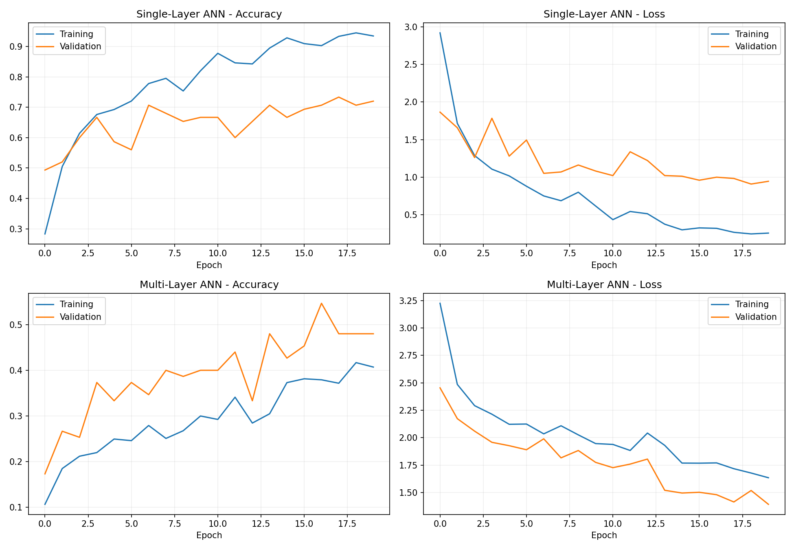
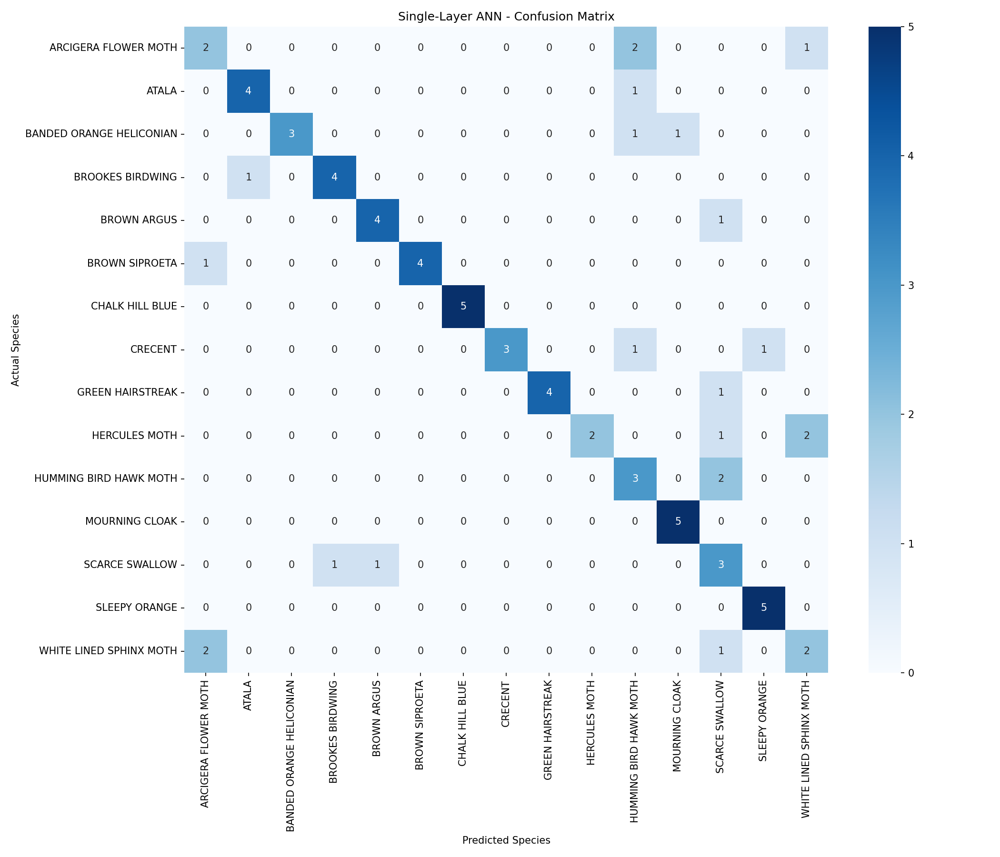
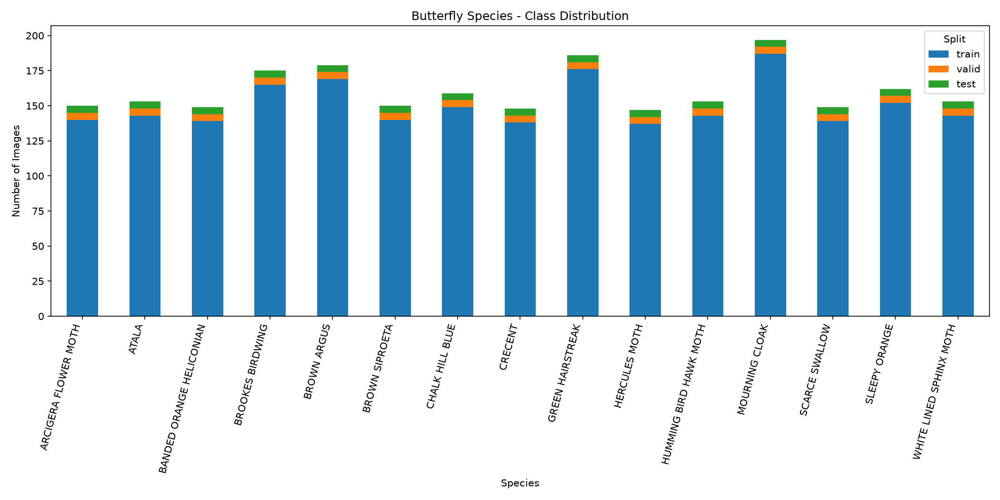

# 🦋 ButterflyAI
### Butterfly and Moth Species Identification Using Artificial Neural Networks

ButterflyAI is an end-to-end deep learning application that identifies
butterfly and moth species from uploaded images.

The project demonstrates image preprocessing, multiclass classification,
single-layer and multilayer feedforward neural networks, model evaluation,
and integration with a modern web application.

## Features

- Upload butterfly or moth images
- Classify images into 15 trained species
- View the predicted species and model confidence
- View the top three predictions
- Explore supported species
- View model performance and evaluation results
- Responsive React frontend
- FastAPI prediction backend

## Dataset

Source: [Butterfly & Moths Image Classification — Kaggle](https://www.kaggle.com/datasets/gpiosenka/butterfly-images40-species)

Original dataset:
- 100 species
- 12,594 training images

Selected experiment:
- 15 species
- 2,260 training images
- 75 validation images
- 75 testing images

The original training, validation, and test splits were preserved
for the selected classes.

## Data Preprocessing

1. Dataset inspection and exploratory data analysis
2. Selection of 15 species
3. Image file validation
4. Removal of unreadable images from the prepared dataset
5. Resizing images to 64 × 64 pixels
6. RGB image conversion
7. Pixel normalization using a Rescaling layer
8. Integer encoding of species labels

## ANN Models

Two feedforward neural networks were trained using TensorFlow/Keras.

### Model 1 — Single-Layer ANN

Architecture:

Input → Rescaling → Flatten → Dense(15, Softmax)

This model uses one trainable output layer without hidden Dense layers.

### Model 2 — Multi-Layer ANN

Architecture:

Input → Rescaling → Flatten →
Dense(256, ReLU) → Dropout(0.3) →
Dense(128, ReLU) → Dropout(0.3) →
Dense(15, Softmax)

### Training Configuration

- Framework: TensorFlow/Keras
- Optimizer: Adam
- Loss: Sparse Categorical Crossentropy
- Batch size: 32
- Maximum epochs: 20
- Early stopping enabled
- Training environment: Google Colab

## Results

| Model | Validation Accuracy | Validation Loss |
|---|---:|---:|
| Single-Layer ANN | 70.67% | 0.9095 |
| Multi-Layer ANN | 48.00% | 1.3922 |

The single-layer ANN achieved the higher validation accuracy
in this experiment and was selected for the deployed API.

These results do not establish that single-layer networks are
universally better than multilayer networks.

The validation and test sets contain only five images per class,
so performance estimates have substantial uncertainty.

### Training Curves



### Confusion Matrix



### Dataset Distribution



## Technologies

**Machine Learning**
- Python
- TensorFlow/Keras
- NumPy
- Pandas
- Scikit-learn
- Matplotlib
- Seaborn
- Pillow

**Backend**
- FastAPI
- Uvicorn

**Frontend**
- React
- Vite
- Tailwind CSS

**Development**
- Visual Studio Code
- Google Colab
- Google Antigravity
- Git and GitHub

## Running the Project Locally

### 1. Clone the repository

```bash
git clone https://github.com/Wajii07/ButterflyAI.git
cd ButterflyAI
```

### 2. Create the Python environment (Windows)

```powershell
py -3.12 -m venv .venv
.\.venv\Scripts\Activate.ps1
```

### 3. Install backend dependencies

```powershell
pip install tensorflow numpy pandas matplotlib seaborn scikit-learn pillow fastapi "uvicorn[standard]" python-multipart
```

### 4. Start FastAPI

From the project root:

```powershell
python -m uvicorn backend.main:app --reload --port 8000
```

API documentation:

http://127.0.0.1:8000/docs

### 5. Start React

Open a second terminal:

```powershell
cd frontend
npm install
npm run dev
```

Open:

http://localhost:5173

## Limitations

- Recognizes only 15 trained classes
- Unsupported images may still receive a prediction
- Softmax confidence is not guaranteed correctness
- Limited validation and test samples per species
- Model performance may differ on real-world images

## Future Improvements

- Expand the number of supported species
- Compare performance against CNN architectures
- Improve generalization using more diverse training data
- Add detection of unsupported images
- Improve species information and identification guidance
- Deploy the application publicly

## Author

Waji Ul Hassan

University Artificial Neural Networks Project
